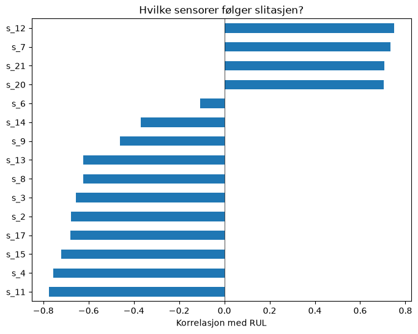
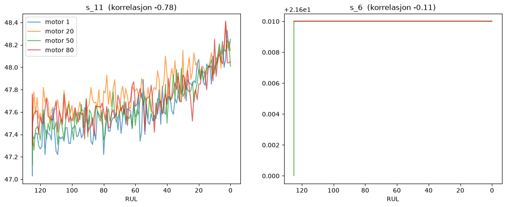
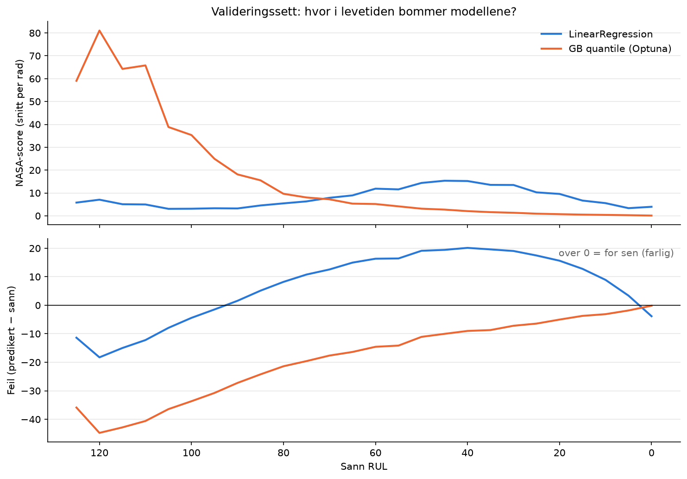
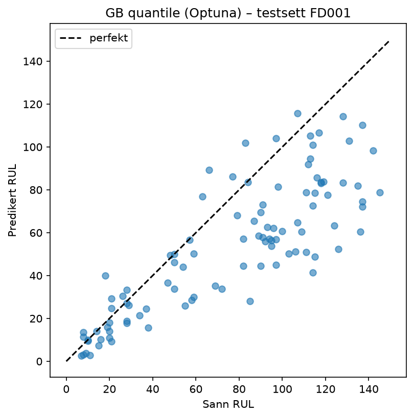
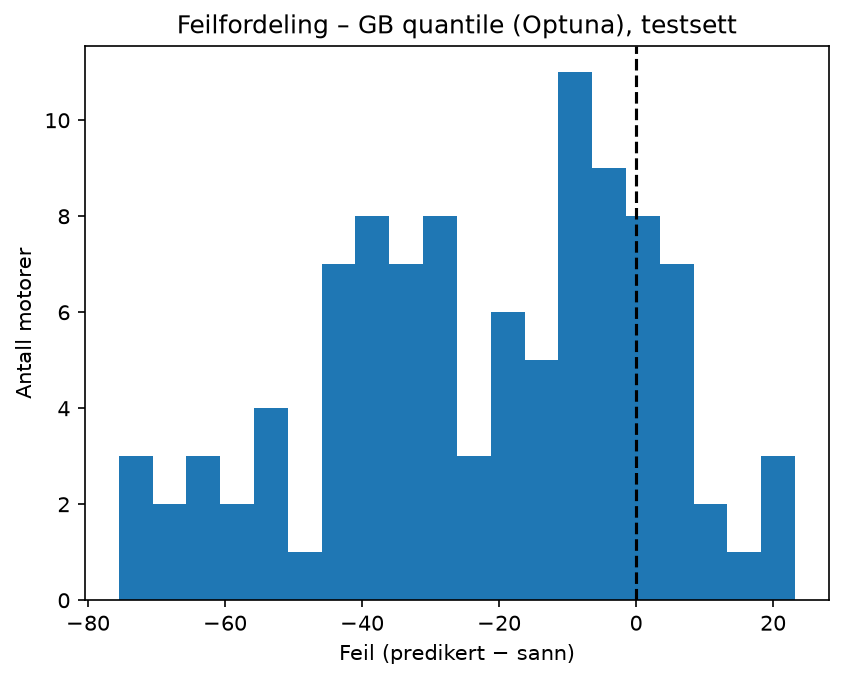
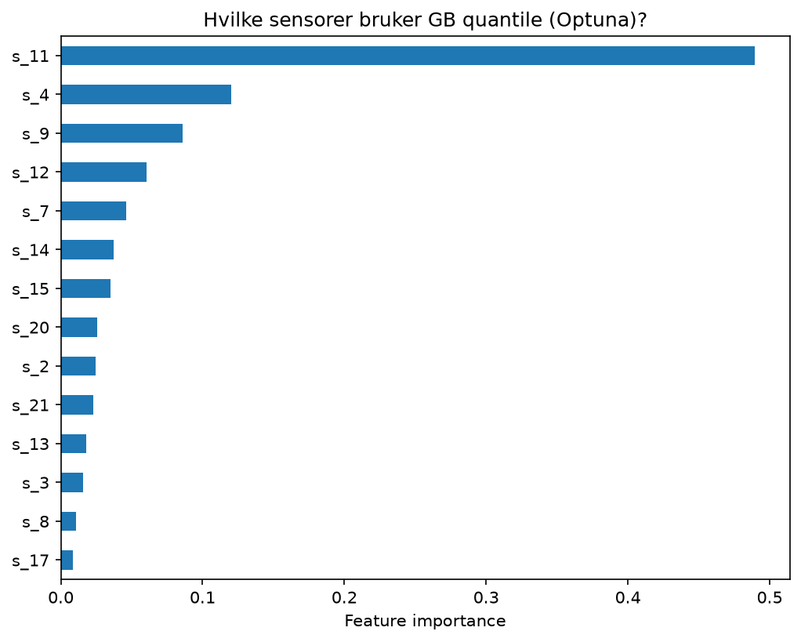
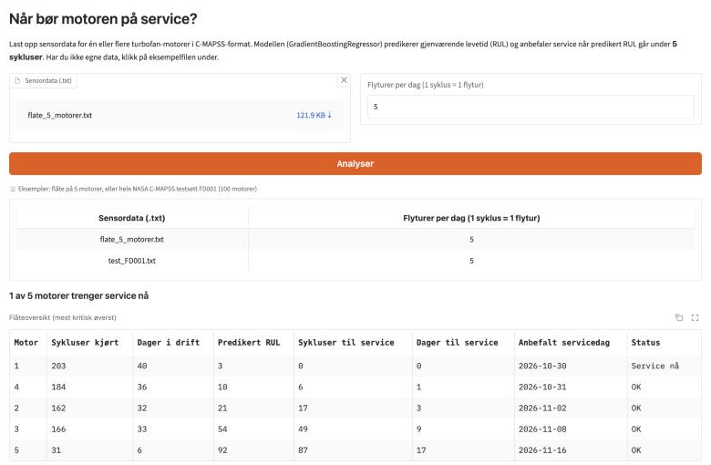
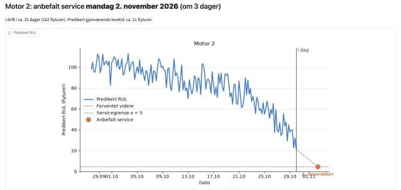

# Når bør motoren på service? Prediksjon av RUL med maskinlæring

Magnus Hannesson Fondenes

GitHub: https://github.com/184887/cmapss-rul  
Nettside: https://cmapss-rul.onrender.com

## 1: Beskriv problemet

### 1.1 Scope

Motorene i en flyflåte slites ned ulikt, men service planlegges fortsatt med faste intervaller. Siden man ikke vet hvor slitt hver motor er, må intervallene settes tidlig nok til at man er sikker på at motorene ikke feiler. Planlegger man service for tidlig, blir det svært kostbart. Å ta den for sent er likevel enda verre, fordi det i verste fall kan føre til at flyet styrter.

Målet med systemet er å forutsi hvor mange sykluser en motor har igjen før den svikter, og ut fra det anbefale en dato da motoren bør tas inn til service. Systemet er tiltenkt den som har ansvar for når motorene i flåten går inn til service.

En servicetekniker kan ikke bare se på én sensor og bestemme ut fra den. Motorene har 21 sensorer, hvorav 14 endrer seg med slitasjen, og det er vanskelig å se ut fra dem hvor nær svikt en motor er. Det er mye lettere for en ML-modell, som er god på å oppdage små forskjeller og sammenhenger mellom mange input.

Hvordan bruke systemet:

1. Brukeren laster opp sensordata for flåten og velger hvor mange flyturer motorene er planlagt å fly per dag. Det er lagt ved eksempeldata for testing.
2. Systemet viser en oversikt over flåten med den mest kritiske motoren øverst. For hver motor kan brukeren se en graf over predikert gjenværende levetid over tid, med servicegrensen markert.
3. Systemet anbefaler en servicedato for hver motor.

Fordelen er at hver motor kan tas inn til service nærmere når den faktisk trenger det, i stedet for etter et fast intervall. Slik utnytter man mer av levetiden og sparer penger på service, samtidig som en valgt sikkerhetsmargin gjør at risikoen for piloter og passasjerer holdes lav.

Prosjektet er laget med simulerte data fra NASA, modellen er trent på egen PC, og nettsiden ligger gratis på nettet.

### 1.2 Metrics

RMSE brukes som standardmål for å kunne sammenligne med andre arbeider på samme datasett. Svakheten er at den straffer for tidlige og for sene prediksjoner like mye.

NASA-score er også et feilmål, men den er asymmetrisk og eksponentiell: en for sen prediksjon straffes mye hardere enn en like stor for tidlig prediksjon. Det passer dette problemet, fordi for sen service er det som kan føre til svikt.

For å velge modell brukes NASA-score, men bare når motoren har 40 sykluser eller mindre igjen. Det er i denne perioden man må bestemme når motoren skal til service.
Når en motor har mye levetid igjen, betyr det lite om modellen bommer litt. Nær svikt er det derimot viktig at modellen treffer, fordi en for sen prediksjon kan føre til at motoren går for lenge.
Grensen på 40 sykluser er valgt fordi det tilsvarer omtrent én uke med 4 til 6 flyturer per dag. Da har man tid til å planlegge å få motoren inn på service.

### 1.3 Servicegrense og suksesskriterium

Modellen kan bomme og tro at motoren har mer igjen enn den har. Derfor sender man motoren på service når modellen sier den har under x sykluser igjen. x er satt slik at 95 % av motorene får service før de svikter. For modellen jeg valgte ble x = 4,5 sykluser. Vil man ta mindre risiko, kan man øke prosenten, men da kommer motorene tidligere inn.

Systemet er bra nok når modellen slår de enkle modellene, lineær regresjon (LR) og gjennomsnitt, på NASA-score nær svikt. Minst 95 % av motorene må få service før de svikter, og x må være godt under 40, slik at man har tid til å planlegge.

## 2: Data

Datasettet kommer fra NASA, som har laget et datasett med simulerte motorer som går til svikt. Datasettet er delt inn i fire deler, FD001 til FD004, som har ulik kompleksitet. Jeg har valgt å bruke FD001, som er den enkleste, med én driftstilstand og én feiltype. Videre utvikling av modellen kunne man gjort på de andre datasettene, men det er ikke gjort i dette prosjektet ennå.

### 2.1 Datasett og mengde

Dataene er laget med en MATLAB-simulering, siden man ikke lar ekte motorer gå til svikt, og firmaer holder dataene sine hemmelige. Det er 100 motorer i treningssettet og 100 motorer i testsettet. I treningssettet har hver motor et ulikt antall sykluser før den svikter, fra 128 til 362 sykluser. Hver syklus har 21 sensorer og 3 driftsinnstillinger.

### 2.2 Label (RUL)

RUL eller Remaining Useful Life er antall sykluser en motor har igjen før den svikter. RUL er labelen som modellen skal predikere. I treningssettet går motorene helt til svikt, så RUL kan regnes ut som siste syklus minus nåværende syklus. I testsettet stopper motorene før svikt, og den sanne RUL-en for siste syklus er gitt i en egen fil.

RUL er kuttet ved 125. Tidlig i livet er motoren frisk, og sensorene endrer seg nesten ikke. Da kan ikke modellen se forskjell på en motor med 300 og en med 200 sykluser igjen, så det gir ikke mening å be den gjette det. Derfor settes RUL til maks 125.

### 2.3 Rensing og features

Sensorer som ikke endrer seg ved mer slitasje er fjernet. Det gjelder 7 av de 21 sensorene (s_1, s_5, s_6, s_10, s_16, s_18 og s_19), som er konstante gjennom hele levetiden og derfor ikke sier noe om hvor nær svikt motoren er. De 14 sensorene som er igjen, brukes direkte som features. Driftsinnstillingene er ikke brukt, siden FD001 bare har én driftstilstand. S_11 er den sensoren som endrer seg mest med slitasjen, og den er derfor valgt som eksempel for å vise hvordan en sensor endrer seg mot RUL. S_6 er valgt som eksempel på en sensor som ikke endrer seg med slitasjen.

### 2.4 Skalering

Noen modeller bryr seg om hvor store tallene er, og andre gjør det ikke. Trær og lineær regresjon fungerer fint uten skalering, så der er dataene brukt som de er. KNN, SVR og MLP sammenligner avstander, og da ville sensorene med store tall bestemt for mye. Derfor er sensorene skalert med StandardScaler for disse modellene. Skaleringen er lagt inn i en Pipeline, så den bare bruker treningsdataene.

### 2.5 Etikk og begrensninger

Det er ingen persondata å tenke på her. Det store etiske spørsmålet er sikkerheten til passasjerene og pilotene. Hvis modellen tar feil, er det vanskelig å si hvem som har ansvaret for ulykken, er det utvikleren som har trent modellen, eller teknikeren som bruker den? Det er derfor viktig at modellen er så sikker som mulig, og at den ikke tar for stor risiko. Derfor er det valgt å bruke NASA-score som feilmål, og å sette x slik at 95 % av motorene får service før de svikter.

Det er også noen begrensninger. Dataene er simulerte, og ekte motorer har mer støy og flere typer feil. FD001 har bare én driftstilstand og én feiltype, så modellen vet ikke hva den skal gjøre med motorer som flyr under andre forhold. Det er heller ikke så mange motorer, bare 100 i treningssettet. Til slutt er det antatt at én syklus er én flytur, og det er ikke sjekket mot ekte data.

## 3: Modellering

### 3.1 Oppsett og validering

Treningsdataene er delt 80/20, der 80 % brukes til trening og 20 % brukes til validering. Hver motor havner enten i treningssettet eller i valideringssettet, men ikke i begge. Det er gjort for å unngå at modellen lærer seg motorene, og heller lærer seg hvordan sensordataene endrer seg med slitasjen. For å sammenligne modellene er det brukt kryssvalidering med 5 deler, også den delt per motor. Valideringssettet er brukt én gang til slutt, for å sjekke modellen jeg valgte og for å sette x. Testsettet er bare brukt helt til slutt.

### 3.2 Baseline

For å vite om modellene faktisk lærer noe, er de sammenlignet med to enkle modeller. Den første gjetter bare gjennomsnittet for alle motorer. Den andre er lineær regresjon, som er den enkleste modellen som faktisk bruker sensorene. En modell må slå begge for å være verdt å bruke.

### 3.3 Modeller og hyperparametersøk

Det er testet flere modeller, både trebaserte modeller og andre som KNN, SVR og et lite nevralt nett. Lineær regresjon fikk best NASA score nær svikt, selv om den hadde dårligst RMSE. De andre modellene traff bedre i snitt, men bommet mye på noen få motorer nær svikt. Så jeg kunne ikke bare se på RMSE når jeg skulle velge modell.

Etter det er ExtraTrees og GradientBoosting finjustert med 50 tilfeldige forsøk hver. ExtraTrees kom ned i 15,2, men slo fortsatt ikke lineær regresjon.

Til slutt er Optuna brukt på GradientBoosting med 100 forsøk. Her fikk den også velge hvordan modellen straffes for feil. Det beste var quantile loss, som gjør at modellen heller gjetter for lavt enn for høyt. Det passer bra her, siden det er farligst å komme for sent. Denne modellen fikk 1,15 mot 14,8 for lineær regresjon, og ble valgt.

| Modell                   | NASA ≤ 40 (CV) | RMSE (CV) |
| ------------------------ | -------------- | --------- |
| Lineær regresjon         | 14,8           | 22,0      |
| GradientBoosting         | 22,0           | 19,0      |
| ExtraTrees               | 22,0           | 19,0      |
| MLP                      | 22,8           | 18,7      |
| RandomForest             | 24,2           | 19,1      |
| HistGradientBoosting     | 27,0           | 19,0      |
| SVR                      | 28,4           | 19,2      |
| KNN                      | 42,8           | 20,6      |
| ExtraTrees (tunet)       | 15,2           | –         |
| GradientBoosting (tunet) | 20,6           | –         |
| GB quantile (Optuna)     | 1,15           | –         |

### 3.4 Valgt modell og resultater

Hvis man ser på alle tallene samlet, ser lineær regresjon bedre ut enn modellen jeg valgte. Den har lavere RMSE og lavere NASA-score på testsettet.

Grunnen til at jeg likevel valgte GB quantile ser man i figurene under. Når motoren har mye levetid igjen, gjetter GB quantile for lavt. Det gir høy straff, men det er ikke farlig, motoren kommer bare litt tidlig inn på service. Nær svikt treffer GB quantile nesten helt riktig. Lineær regresjon gjetter derimot for høyt akkurat der, og det er det farlige.

Nær svikt fikk GB quantile en NASA-score på 0,77, mot 8,39 for lineær regresjon.

| Modell               | NASA ≤ 40 (val) | RMSE (val) | RMSE (test) | NASA (test) |
| -------------------- | --------------- | ---------- | ----------- | ----------- |
| Gjennomsnitt (Dummy) | 1505,8          | 41,7       | 43,1        | 34 053      |
| Lineær regresjon     | 8,39            | 20,4       | 21,9        | 1 299       |
| GB quantile          | 0,77            | 33,4       | 32,3        | 2 608       |

### 3.5 Feilanalyse

På testsettet var det 28 motorer som hadde 40 sykluser eller mindre igjen. For disse fikk GB quantile en NASA-sum på 30, mens lineær regresjon fikk 756. Det er nær svikt man bestemmer når motoren skal på service, og der er GB quantile mye bedre.

Et eksempel: har en motor egentlig 120 flyturer igjen og modellen sier 80, er det en stor feil, men den er ufarlig, fordi ingen beslutning tas ennå. Har motoren 20 igjen og modellen sier 35, kan det føre til at motoren går for lenge.

Modellen har likevel svakheter. Den gjetter mye for lavt langt fra svikt, så den kan ikke brukes til å si hvor lenge en frisk motor vil vare. Prediksjonene hopper også litt fra syklus til syklus, og servicedatoen er bare basert på den siste. I tillegg er RUL kuttet ved 125, så modellen sier aldri mer enn 125 igjen.

### 3.6 Feature importance

Figuren viser hvor mye modellen bruker hver sensor. S_11 er klart viktigst og står for nesten halvparten, og deretter kommer s_4 og s_9. S_11 og s_4 har sterkest sammenheng med RUL. Noen sensorer, som s_17, s_3 og s_8, har også sterk sammenheng med RUL, men blir nesten ikke brukt. Det er trolig fordi de viser det samme som s_11 og s_4, så modellen får lite nytt ut av dem. S_9 har svakere sammenheng, men er likevel nummer tre, så den ser ut til å gi informasjon som de andre ikke har.

### 3.7 Sammenligning med andre arbeider

Babu mfl. (2016) brukte et nevralt nett (CNN) på samme datasett og fikk RMSE på 18,45. Lineær regresjon i dette prosjektet fikk 21,9, som ikke er så langt unna. GB quantile fikk 32,3, men den er laget for å treffe best nær svikt, ikke for å få lav RMSE. Babu mfl. ser også på flere sykluser om gangen, mens modellene her bare ser på én.

## 4: Deployment

### 4.1 Hvordan systemet er deployet

Nettsiden er laget med Gradio og ligger gratis på Render. Modellen er trent på egen PC i notebooken og lagret i én fil sammen med servicegrensen x, listen over sensorer og versjonen av scikit-learn. Nettsiden laster bare inn denne filen, så den trenger ikke trene noe selv. Versjonene av pakkene er låst i requirements.txt, fordi en lagret modell ofte ikke virker med en annen versjon av scikit-learn. Render henter koden fra GitHub og starter nettsiden. Siden det er en gratisplan, sovner den når ingen bruker den, så første besøk kan ta 30–60 sekunder.Så på å bruke Hugging Face men det var noe betalings blokkere.

### 4.2 Hvordan prediksjonene brukes

Brukeren laster opp en fil med sensordata i samme format som NASA-dataene og velger hvor mange flyturer motorene flyr per dag. Jeg har lagt ved noen ekesempelfiler siden jeg regner med at alle som skal teste systmet ikke har en flåte med fly. Systemet viser en oversikt over flåten med den mest kritiske motoren øverst. For hver motor kan brukeren se en graf over predikert RUL over tid, med servicegrensen markert. Systemet anbefaler også en servicedato for hver motor.

### 4.3 Overvåking og vedlikehold

I dag blir ikke systemet overvåket. Hvis det skulle brukes på ekte, så burde det vært en mulighet for en tekniker å rapportere tilbake om mortoren sviktet før service, eller om den hadde mye levetid igjen. Da kunne man sett om modellen bommet og trent den på nytt. Det burde også vært en måte å oppdatere modellen på, for eksempel med en ny fil som lastes opp til nettsiden.

### 4.4 Svakheter og forbedringer

Man kunne trent modellen på flere datasett, for eksempel FD002, FD003 og FD004, som har flere driftstilstander og feiltyper. Da kunne man laget en modell som fungerer under flere forhold. Man kunne også trent den på ekte data, men det er vanskelig å få tak i.

## 5: Referanser

- Saxena, A., Goebel, K., Simon, D., & Eklund, N. (2008). Damage propagation modeling for aircraft engine run-to-failure simulation. _International Conference on Prognostics and Health Management (PHM08)_.
- NASA Prognostics Center of Excellence – PCoE Data Set Repository: https://www.nasa.gov/intelligent-systems-division/discovery-and-systems-health/pcoe/pcoe-data-set-repository/
- Babu, G. S., Zhao, P., & Li, X.-L. (2016). Deep Convolutional Neural Network Based Regression Approach for Estimation of Remaining Useful Life. _DASFAA 2016_.
- Pedregosa, F. et al. (2011). Scikit-learn: Machine Learning in Python. _JMLR_ 12, 2825–2830.
- Akiba, T. et al. (2019). Optuna: A Next-generation Hyperparameter Optimization Framework. _KDD_.
- Gradio: https://www.gradio.app/
- Render: https://render.com/

- Anthropic Claude Code: KI-verktøy ble brukt til å hjelpe med noe kode skriving en god del på såesielt netsiden, samt til å se over og gi tilbake meldinger på raporten ved litt skive hjelp og retskrivings forslag. Og fylle inn kilder. Brukte det osgå til å scafolde raporten og selve kode strukturen.
